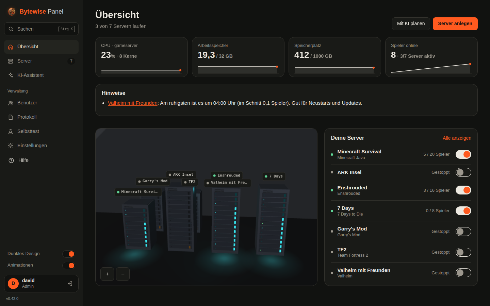
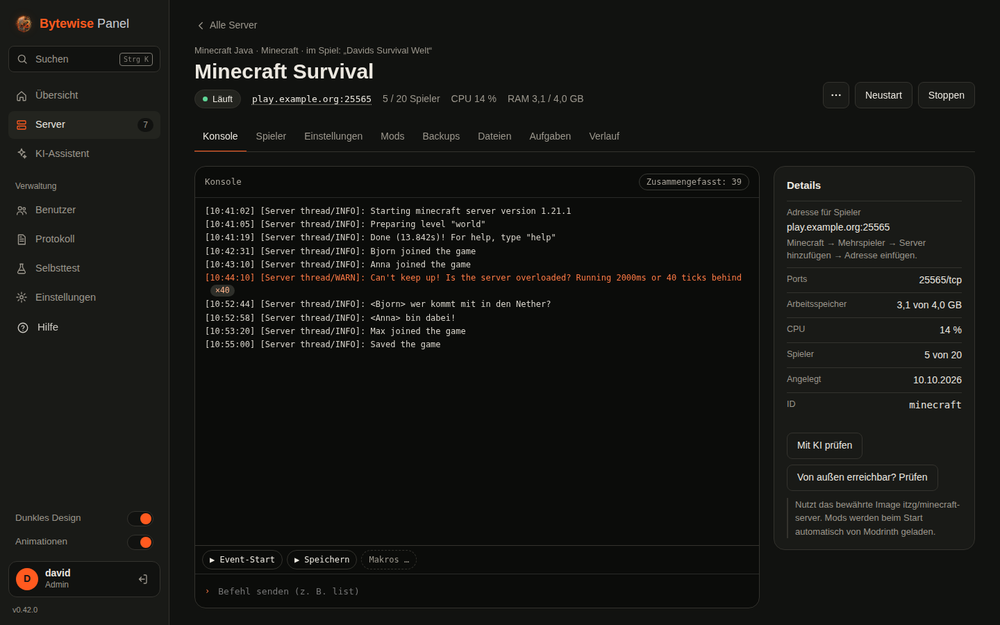

<p align="center">
  
</p>

<p align="center">
  <b>Ein selbst gehostetes Gameserver-Panel, das dir die lästige Arbeit abnimmt.</b><br>
  Eine Datei, Docker im Hintergrund, 3D-Übersicht, KI-Assistent. Freie Software (AGPL-3.0).
</p>

<p align="center">
  <a href="README.md">English</a> ·
  <a href="#installation">Installation</a> ·
  <a href="docs/handbuch.md">Handbuch</a> ·
  <a href="CHANGELOG.md">Changelog</a>
</p>



## Worum es geht

Gameserver für Freunde heißt meist: SSH, Portfreigaben, Update-Skripte und viel „Warum kommt keiner rein?“. Bytewise Panel packt das hinter eine Weboberfläche, die auch am Handy funktioniert, und erklärt in normalen Worten, was los ist.

- **Server in einer Minute.** Spiel wählen, Namen und RAM festlegen. Das Panel lädt das Spiel über SteamCMD oder ein bewährtes Docker-Image, wählt freie Ports, öffnet sie im Router (UPnP) und prüft, ob der Server von außen erreichbar ist.
- **Die KI hilft.** Aus „Valheim für 6 Freunde, etwas schwerer“ wird ein Plan, den du freigibst. Ein vorhandener Server wird „Highrate am Wochenende“ und stellt sich danach selbst zurück. Geht etwas schief, liest die KI die Konsole und schlägt eine Lösung vor, die du mit einem Klick übernimmst.
- **Kein Babysitten mehr.** Neustarts und Updates zur ruhigsten Stunde, nur wenn niemand spielt, mit Vorwarnung im Spiel und Backup vorher. Ein Wächter startet abgestürzte oder hängende Server neu.
- **Schön für deine Mitspieler.** Eine öffentliche Statusseite mit Online-Liste, Beitreten-Knopf, Verfügbarkeit, Event-Kalender und Wunschliste. Ein Discord-Bot für `/status`, `/start` und Whitelist-Anfragen. Einladungslinks, Mod-Paket zum Herunterladen, Saisons mit Ruhmeshalle.

## Funktionen

| | |
|---|---|
| **Spiele** | Rund 20 sorgfältig gepflegte Vorlagen (Minecraft Java/Bedrock, Valheim, Palworld, Enshrouded, Rust, 7 Days to Die, Project Zomboid, Satisfactory, Factorio, Terraria, …) und 130 Community-Vorlagen aus LinuxGSM und AMPTemplates. Jedes SteamCMD-Spiel über „Eigenes Steam-Spiel“. Ein eingebauter Selbsttest prüft Vorlagen auf deinem Rechner. |
| **Einstellungen** | Jeder Wert in den Config-Dateien eines Spiels wird zum Formularfeld, mit Suche, Wertebereichen und Erklärungen; frühere Stände lassen sich zurückholen. |
| **Mods** | Modrinth für Minecraft, Steam Workshop für Steam-Spiele, Update-Hinweise, Mod-Paket für Mitspieler (z. B. BepInEx-Spiele). |
| **Konsole** | Live-Konsole mit Befehlseingabe, gespeicherte Makros und Zusammenfassen von Log-Fluten („×56“). |
| **Backups** | Mit Zeitplan und Aufbewahrung, Wiederherstellen, Herunter- und Hochladen, externes Ziel (Ordner oder S3-kompatibler Speicher). |
| **Spieler** | Online-Liste, Kick/Bann/Whitelist/OP wo das Spiel es kann, Spielzeit-Statistik, Karte, von wo Spieler verbinden. |
| **Mehrere Rechner** | Weitere Rechner koppeln und alle Server von einem Panel aus verwalten; Server zwischen Rechnern umziehen. |
| **Sicherheit** | Rollen (Admin, Betreiber, Zuschauer) je Server, Zwei-Faktor-Anmeldung, Protokoll, HTTPS (selbst signiert, Let's Encrypt, eigenes Zertifikat oder Reverse Proxy). |
| **Smart Home** | Philips Hue und Home Assistant reagieren auf Ereignisse: Lampe blinkt grün, wenn ein Freund beitritt, pulsiert rot bei einem Absturz, Alexa oder ein Lautsprecher sagt an, wer online ist. |
| **Handy** | Als App installierbar, Push-Nachrichten je Gerät (Abstürze, Updates, Spieler kommen), Zahl der Probleme auf dem App-Symbol, Android-Widget über KWGT. |
| **Automatisierung** | API-Schlüssel für Skripte und Home Assistant, signierte Webhooks (Status, Spieler, Abstürze, Backups …), Benachrichtigungen über Discord oder ntfy. |
| **Sprachen** | Deutsch und Englisch, je Benutzer umschaltbar. |

<table>
  <tr>
    <td></td>
    <td></td>
  </tr>
</table>

<p align="center"></p>

## Installation

Du brauchst einen Linux-Rechner (x86_64 oder ARM64) mit systemd, z. B. Debian, Ubuntu, Fedora oder Arch. Am besten eine eigene VM; in einem unprivilegierten LXC-Container macht Docker oft Ärger.

```bash
curl -fsSL https://github.com/derface/Gameserver-controlPanel/releases/latest/download/install.sh | sudo bash
```

Das Skript installiert bei Bedarf Docker, richtet den Dienst `gamepanel` ein und zeigt die Adresse, z. B. `http://192.168.1.20:8420`. Dort legst du dein Admin-Konto an; ein kurzer Assistent hilft mit Adresse für Mitspieler, Portfreigabe, HTTPS und dem ersten Server.

Optionen: `--port 9000`, `--binary ./gamepanel-linux-amd64` (lokale Datei installieren), `--uninstall` (mit `--purge` auch alle Gameserver und Daten löschen).

**Aktualisieren:** Einstellungen → Panel & Updates → „Jetzt aktualisieren“, oder den Installationsbefehl erneut ausführen. Gameserver und Spielstände bleiben erhalten.

**Selbst bauen** (Go 1.24, sonst keine Abhängigkeiten): `make dist` erzeugt `dist/gamepanel-linux-amd64`, `-arm64` und `install.sh`.

Alles Weitere steht im [Handbuch](docs/handbuch.md).

## KI-Anbieter

Die KI-Funktionen sind optional. Du nutzt deinen eigenen Schlüssel für Anthropic (Claude) oder OpenAI, oder ein lokales Modell über Ollama. Bevor etwas verschickt wird, entfernt das Panel Passwörter, IP-Adressen, E-Mail-Adressen und Steam-IDs.

## Stand

Das Panel läuft täglich auf einem Homeserver, ist aber jung und entwickelt sich schnell. Vorlagen mit Status *beta* oder *experimentell* haben den automatischen Selbsttest bestanden oder sind noch ungetestet; *stabil* heißt: wirklich darauf gespielt. Fehlerberichte und Spielwünsche gern als [Issue](../../issues).

## Mitmachen

Siehe [CONTRIBUTING.md](CONTRIBUTING.md). Sicherheitslücken bitte nach [SECURITY.md](SECURITY.md) melden, nicht als öffentliches Issue.

## Lizenz

Bytewise Panel ist freie Software unter der [GNU Affero General Public License v3.0](LICENSE): kostenlos nutzen, verändern und weitergeben. Wer eine veränderte Fassung anderen über das Netz anbietet, muss deren Quellcode ebenfalls veröffentlichen.

Fremdbestandteile: `internal/thirdparty/acme` (BSD), three.js und qrcode.js (MIT), Vorlagen-Daten aus [LinuxGSM](https://github.com/GameServerManagers/LinuxGSM) und [AMPTemplates](https://github.com/CubeCoders/AMPTemplates) (MIT). IP-Geolokalisierung von [DB-IP](https://db-ip.com) (CC BY 4.0). Bytewise Panel steht in keiner Verbindung zu Spieleherstellern, Valve, CubeCoders oder LinuxGSM.
