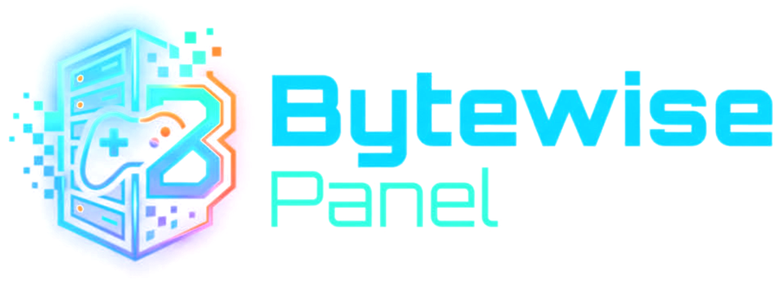
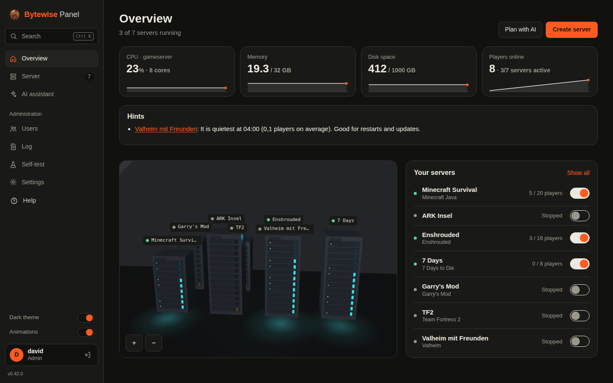
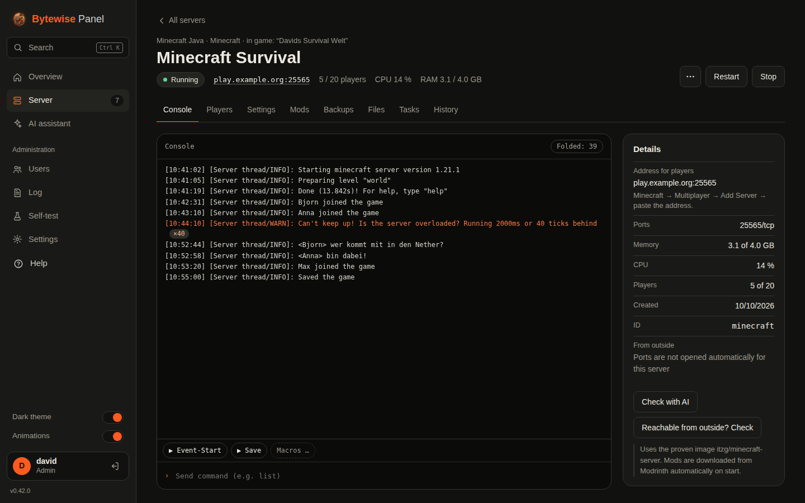
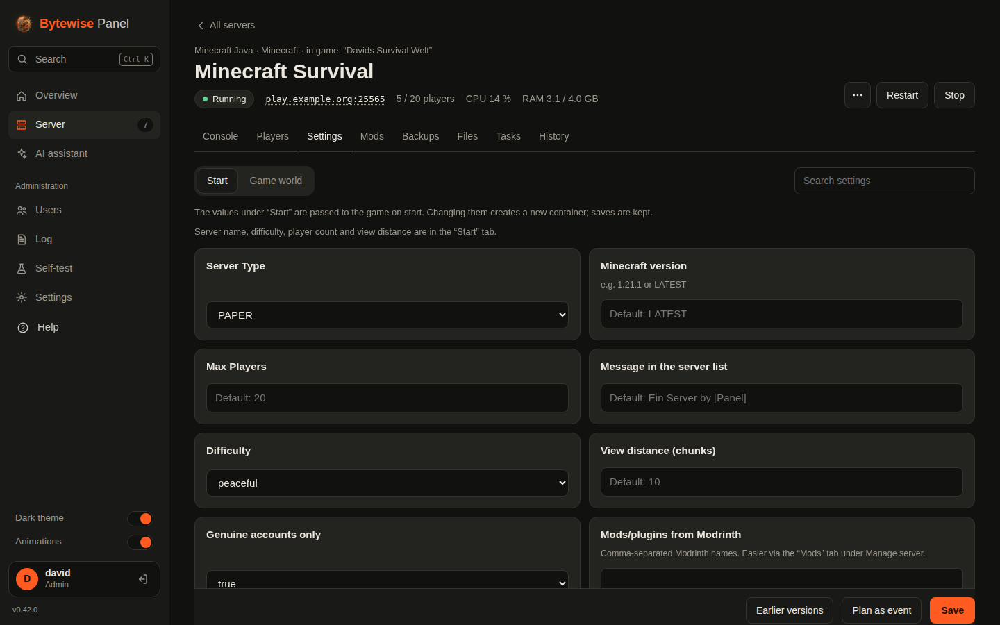
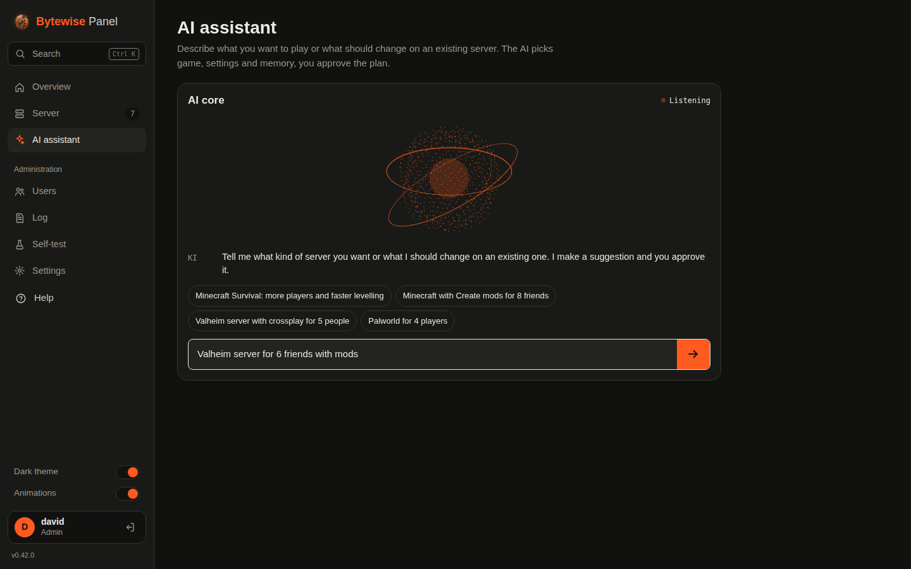
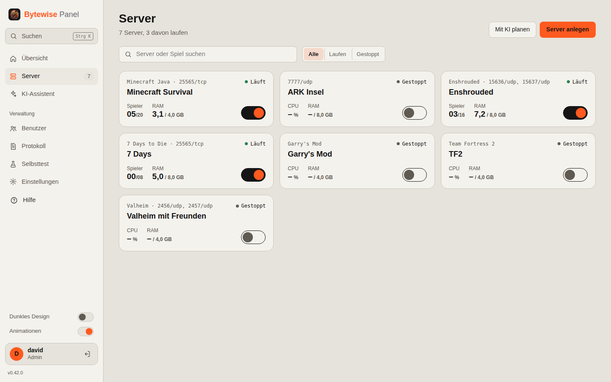
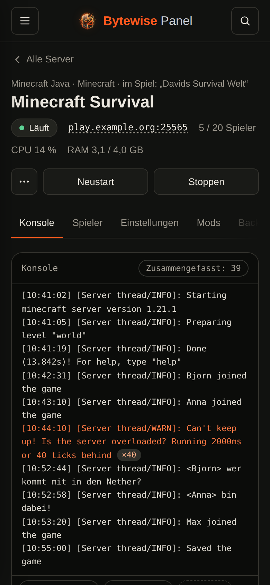

<p align="center">
  
</p>

<p align="center">
  <b>A self-hosted game server panel that does the boring parts for you.</b><br>
  One binary, Docker under the hood, 3D overview, AI assistant. Free software (AGPL-3.0).
</p>

<p align="center">
  <a href="README.de.md">Deutsch</a> ·
  <a href="#install">Install</a> ·
  <a href="docs/handbuch.md">Manual (German)</a> ·
  <a href="CHANGELOG.md">Changelog</a>
</p>



## Why

Running game servers for friends usually means SSH, port forwarding, update scripts and a lot of “why can't anyone join?”. Bytewise Panel puts all of that behind a web interface that also works on a phone, and explains what is going on in plain words.

- **Create a server in a minute.** Pick a game, give it a name and some RAM. The panel downloads it via SteamCMD or a proven Docker image, picks free ports, opens them in your router (UPnP) and checks that the server is reachable from the internet.
- **Let the AI help.** “Valheim for 6 friends, a bit harder” turns into a plan you approve. An existing server becomes “highrate on the weekend” and switches back on its own. When something breaks, the AI reads the console and suggests a fix you apply with one click.
- **Stop babysitting.** Scheduled restarts and updates at the quietest hour, only when nobody is online, with a warning in-game and a backup first. A watchdog restarts crashed or hung servers.
- **Make it nice for your players.** A public status page with who's online, join button, uptime, event calendar and a wish list. A Discord bot for `/status`, `/start` and whitelist requests. Invite links, a downloadable mod pack, seasons with a hall of fame.

## Features

| | |
|---|---|
| **Games** | About 20 hand-tuned templates (Minecraft Java/Bedrock, Valheim, Palworld, Enshrouded, Rust, 7 Days to Die, Project Zomboid, Satisfactory, Factorio, Terraria, …) plus 130 community templates generated from LinuxGSM and AMPTemplates. Any SteamCMD game via “custom Steam game”. A built-in self-test checks templates on your machine. |
| **Settings** | Every value in a game's config files becomes a form field with search, ranges and explanations; earlier versions can be restored. |
| **Mods** | Modrinth for Minecraft, Steam Workshop for Steam games, update notices, a downloadable mod pack for players (e.g. BepInEx games). |
| **Console** | Live console with command input, saved macros, and folding of log floods (“×56”). |
| **Backups** | Scheduled with retention, restore, download/upload, external targets (folder or S3-compatible storage). |
| **Players** | Online list, kick/ban/whitelist/op where the game supports it, play time statistics, map of where players connect from. |
| **Multiple machines** | Pair more machines and manage all servers from one panel; move servers between machines. |
| **Security** | Roles (admin, operator, viewer) per server, two-factor login, audit log, HTTPS (self-signed, Let's Encrypt, own certificate or reverse proxy). |
| **Automation** | API keys for scripts and Home Assistant, signed webhooks (status, players, crashes, backups …), notifications via Discord or ntfy. |
| **Languages** | English and German, switchable per user. |

<table>
  <tr>
    <td></td>
    <td></td>
  </tr>
  <tr>
    <td></td>
    <td></td>
  </tr>
</table>

<p align="center"></p>

## Install

You need a Linux machine (x86_64 or ARM64) with systemd, for example Debian, Ubuntu, Fedora or Arch. A dedicated VM works best; Docker tends to cause trouble inside unprivileged LXC containers.

```bash
curl -fsSL https://github.com/derface/Gameserver-controlPanel/releases/latest/download/install.sh | sudo bash
```

The script installs Docker if needed, sets up the `gamepanel` service and prints the address, e.g. `http://192.168.1.20:8420`. Open it, create your admin account, and a short setup wizard walks you through player address, port forwarding, HTTPS and your first server.

Options: `--port 9000`, `--binary ./gamepanel-linux-amd64` (install a local file), `--uninstall` (add `--purge` to also delete all game servers and data).

**Updating:** Settings → Panel & Updates → “Update now”, or run the install command again. Game servers and saves are kept.

**Build it yourself** (Go 1.24, no other dependencies):

```bash
git clone https://github.com/derface/Gameserver-controlPanel.git
cd Gameserver-controlPanel
make dist      # dist/gamepanel-linux-amd64, -arm64 and install.sh
```

Useful commands: `journalctl -u gamepanel -f` (panel log), `docker ps --filter label=gamepanel.id` (game server containers). Data lives in `/var/lib/gamepanel`.

## AI providers

The AI features are optional. Bring your own key for Anthropic (Claude) or OpenAI, or run a model locally with Ollama. Before anything is sent, the panel removes passwords, IP addresses, e-mail addresses and Steam IDs.

## Status

The panel is used daily on a home server, but it is young and changes quickly. Templates marked *beta* or *experimental* passed the automatic self-test or have not been tested yet; *stable* ones were played on. Bug reports and game requests are welcome via [issues](../../issues).

## Contributing

See [CONTRIBUTING.md](CONTRIBUTING.md). Security issues: please follow [SECURITY.md](SECURITY.md) instead of opening a public issue.

## License

Bytewise Panel is free software under the [GNU Affero General Public License v3.0](LICENSE). You may use, change and share it for free. If you offer a modified version to others over a network, you have to publish its source code too.

Third-party parts: `internal/thirdparty/acme` (BSD), three.js and qrcode.js (MIT), template data from [LinuxGSM](https://github.com/GameServerManagers/LinuxGSM) and [AMPTemplates](https://github.com/CubeCoders/AMPTemplates) (MIT). IP geolocation by [DB-IP](https://db-ip.com) (CC BY 4.0). Bytewise Panel is not affiliated with any game publisher, Valve, CubeCoders or LinuxGSM.
